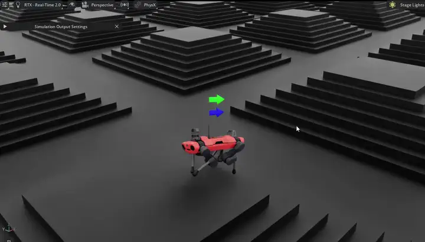

# Learning Robust Quadruped Locomotion with Isaac Lab

## Overview

This project trains an ANYmal C quadruped with PPO to track planar velocity commands across flat and procedurally
generated rough terrain. The work progresses from standing and disturbance recovery to command-conditioned
locomotion, terrain curricula, controlled gait evaluation, domain randomization, and held-out physics tests.

## Demo



The preview shows the trained policy traversing several terrain families at 4× playback speed.

The complete locomotion, domain-randomization, and held-out OOD evaluation methodology and findings are
documented in [DOMAIN_RANDOMIZATION_REPORT.md](DOMAIN_RANDOMIZATION_REPORT.md).

**Key Features:**

- Direct Isaac Lab environment with velocity tracking, rough terrain, external pushes, and keyboard control
- PPO training and playback through RSL-RL
- Terrain curriculum and separate nominal, randomized, and held-out physics configurations
- Reproducible policy and gait evaluation with paired comparisons and bootstrap confidence intervals
- Selected checkpoints, exported policies, experiment data, figures, and an interview presentation

**Stack:** Isaac Lab, Isaac Sim, PyTorch, Gymnasium, RSL-RL, TensorBoard

## Project artifacts

- [Domain-randomization study](DOMAIN_RANDOMIZATION_REPORT.md)
- [Controlled gait evaluation](GAIT_EVALUATION_REPORT.md)
- [Phase-clock gait experiment](PHASE_CLOCK_GAIT_REPORT.md)
- [Final presentation](deliverables/Locomotion_Projects_Interview_Walkthrough_PhaseClock.pptx)
- [Selected deployable policy](checkpoints/phase_clock/exported/policy.pt)

## Common commands

Run these commands from the repository root in PowerShell.

### Train with RSL-RL PPO

```powershell
isaaclab -p .\scripts\rsl_rl\train.py --task AnymalTraining-Direct-v0 --run_name standing_v1 --viz none
```

Train the separate rough-terrain policy from scratch:

```powershell
isaaclab -p .\scripts\rsl_rl\train.py --task AnymalTraining-Rough-Direct-v0 --run_name rough_locomotion_v1 --viz none
```

The rough task is traversal-focused: all terrain levels 0-9 remain represented throughout training,
commands last for a complete episode, and episodes terminate on physical base contact rather than nominal
height or tilt. Train this version from scratch instead of resuming a checkpoint trained with the earlier
standing/gait-shaped reward.

### Play the latest trained policy

```powershell
isaaclab -p .\scripts\rsl_rl\play.py --task AnymalTraining-Direct-v0 --viz kit --num_envs 1 --real-time
```

For interactive keyboard commands:

```powershell
isaaclab -p .\scripts\rsl_rl\play.py --task AnymalTraining-Direct-v0 --viz kit --num_envs 1 --real-time env.manual_commands=true
```

Use Up/Down for forward/backward, Left/Right for lateral motion, Z/X for turning, and L to stop.

Play the rough-terrain policy (append `--checkpoint` if needed):

```powershell
isaaclab -p .\scripts\rsl_rl\play.py --task AnymalTraining-Rough-Direct-v0 --viz kit --num_envs 1 --real-time
```

Record a 10-second four-foot contact diagram while playing a checkpoint:

```powershell
isaaclab -p .\scripts\rsl_rl\play.py --task AnymalTraining-Rough-Direct-v0 --checkpoint "C:\path\to\model.pt" --num_envs 1 --plot_gait --gait_plot_duration 10 --viz kit
```

The PNG is saved under the checkpoint run's `gait_plots` directory. Black intervals indicate ground contact,
white intervals indicate swing, and the console prints each foot's duty factor.

### Phase-conditioned gait policy

The phase-clock ablation adds an observable cyclic trot reference and dense contact-schedule feedback while
leaving the established rough-terrain task unchanged. See [PHASE_CLOCK_GAIT_REPORT.md](PHASE_CLOCK_GAIT_REPORT.md)
for the design, failed precursor experiment, controlled metrics, rough-terrain tradeoff, and reproduction steps.

Play the selected model:

```powershell
isaaclab -p .\scripts\rsl_rl\play.py --task AnymalTraining-Rough-PhaseClock-Direct-v0 --checkpoint ".\checkpoints\phase_clock\model_3100_selected.pt" --num_envs 1 --viz kit
```

Run a controlled 1 m/s flat-terrain gait evaluation:

```powershell
isaaclab -p .\scripts\rsl_rl\evaluate_gait.py --task AnymalTraining-Rough-Direct-v0 --checkpoint "C:\path\to\model.pt" --num_envs 64 --seed 42 --warmup 2 --duration 10 --command_vx 1.0 --output_dir ".\gait_evaluation\run_name" --viz none
```

Compare two paired evaluations with bootstrap confidence intervals:

```powershell
isaaclab -p .\scripts\rsl_rl\compare_gait.py .\gait_evaluation\before .\gait_evaluation\after --output .\gait_evaluation\comparison.json
```

Lock play to a particular terrain family and difficulty level (0 is easiest, 9 is hardest):

```powershell
isaaclab -p .\scripts\rsl_rl\play.py --task AnymalTraining-Rough-Direct-v0 --viz kit --num_envs 1 --real-time env.manual_commands=true env.evaluation_terrain_type=boxes env.evaluation_terrain_level=5
```

Valid terrain families are `pyramid_stairs`, `pyramid_stairs_inv`, `boxes`, `random_rough`,
`hf_pyramid_slope`, and `hf_pyramid_slope_inv`. The rough-task camera is relative to environment 0,
so it focuses on the selected patch instead of the center of the complete terrain grid.

While running rough-terrain play with `env.manual_commands=true` and `--num_envs 1`:

- Page Up / Page Down: increase or decrease terrain difficulty.
- N / M: select the previous or next terrain family.
- R: reset ANYmal on the current terrain.
- C: toggle the robot-follow camera so the viewport can be moved manually.

Terrain changes are applied at the next simulation step and automatically reset the robot on the newly
selected patch; the play script does not need to be restarted.

To play a particular model instead, append its full path:

```powershell
--checkpoint "C:\path\to\model_150.pt"
```

### Continue training from a checkpoint

```powershell
isaaclab -p .\scripts\rsl_rl\train.py --task AnymalTraining-Direct-v0 --run_name standing_finetune_v2 --load_run 2026-08-29_17-42-40 --checkpoint model_999.pt --viz none --resume
```

Every training run requires a descriptive `--run_name`. The name is appended to the timestamped log folder,
making checkpoints easy to identify while retaining chronological ordering.

### Evaluate a checkpoint

Run a reproducible baseline evaluation with fixed standing, straight, turning, and combined commands:

```powershell
isaaclab -p .\scripts\rsl_rl\evaluate.py --task AnymalTraining-Rough-Direct-v0 --checkpoint "C:\path\to\model.pt" --num_envs 256 --episodes_per_env 1 --viz none
```

The evaluator disables pushes and curriculum changes, uses seed `42` by default, and writes:

- `episodes.csv`: one row per evaluated episode.
- `summary.csv`: results grouped by terrain family, difficulty, and command mode.
- `summary.json`: metadata, overall results, and grouped results for programmatic comparisons.

Reports are saved under an `evaluations/<timestamp>` folder beside the evaluated checkpoint. Use the same
seed, environment count, and episode count when comparing policies.

### Train with domain randomization

Fine-tune the nominal rough-terrain policy under randomized friction, base mass and center of mass,
actuator gains, reset states, and modest external pushes:

```powershell
isaaclab -p .\scripts\rsl_rl\train.py --task AnymalTraining-Rough-DR-Direct-v0 --run_name dr_finetune_v1 --resume --checkpoint "C:\path\to\nominal\model_1998.pt" --max_iterations 500 --viz none
```

The randomized task uses a separate `anymal_training_rough_dr_direct` experiment folder. The observation and
action spaces and policy architecture are unchanged, so nominal checkpoints are compatible and can be passed
directly as an absolute `--checkpoint` path.

After training, evaluate both checkpoints under the same conditions and seed. The nominal rough task measures
the cost on nominal physics; the domain-randomized task measures robustness across randomized physics:

```powershell
# Nominal physics
isaaclab -p .\scripts\rsl_rl\evaluate.py --task AnymalTraining-Rough-Direct-v0 --checkpoint "C:\path\to\model.pt" --num_envs 256 --episodes_per_env 1 --seed 42 --viz none

# Randomized physics
isaaclab -p .\scripts\rsl_rl\evaluate.py --task AnymalTraining-Rough-DR-Direct-v0 --checkpoint "C:\path\to\model.pt" --num_envs 256 --episodes_per_env 1 --seed 42 --viz none
```

### Fair domain-randomization comparison

The DR fine-tune must be compared against a nominal control that receives the same 500 additional iterations
from the same starting checkpoint:

```powershell
isaaclab -p .\scripts\rsl_rl\train.py --task AnymalTraining-Rough-Direct-v0 --run_name nominal_control_500 --resume --checkpoint "C:\path\to\model_1998.pt" --max_iterations 500 --viz none
```

Evaluate both final checkpoints using identical environment counts and seeds on:

```powershell
# Nominal physics
isaaclab -p .\scripts\rsl_rl\evaluate.py --task AnymalTraining-Rough-Direct-v0 --checkpoint "C:\path\to\model.pt" --num_envs 256 --episodes_per_env 1 --seed 42 --viz none

# Held-out OOD stress physics (never used for training)
isaaclab -p .\scripts\rsl_rl\evaluate.py --task AnymalTraining-Rough-OOD-Direct-v0 --checkpoint "C:\path\to\model.pt" --num_envs 256 --episodes_per_env 1 --seed 42 --viz none
```

The OOD task deliberately samples outside the DR training support: lower contact friction, a heavier base,
a larger center-of-mass offset, weaker stiffness, higher damping, and greater restitution. It is an evaluation
stress test and should not be used for training.

### Launch TensorBoard

```powershell
isaaclab -p -m tensorboard.main --logdir .\logs\rsl_rl\anymal_training_direct
```

For rough-terrain runs, use `--logdir .\logs\rsl_rl\anymal_training_rough_direct`.

Then open <http://localhost:6006> in a browser.

### Environment smoke tests

```powershell
# Display ANYmal in its default standing pose.
isaaclab -p .\scripts\zero_agent.py --task AnymalTraining-Direct-v0 --num_envs 1 --viz kit

# Apply random joint actions (falling is expected).
isaaclab -p .\scripts\random_agent.py --task AnymalTraining-Direct-v0 --num_envs 1 --viz kit

# Confirm that the task is registered.
isaaclab -p .\scripts\list_envs.py
```

## Installation

- Install Isaac Lab by following the [installation guide](https://isaac-sim.github.io/IsaacLab/main/source/setup/installation/index.html).
  We recommend using the conda or uv installation as it simplifies calling Python scripts from the terminal.

- Clone or copy this project/repository separately from the Isaac Lab installation (i.e. outside the `IsaacLab` directory):

- Using a python interpreter that has Isaac Lab installed, install the library in editable mode using:

    ```bash
    # use 'PATH_TO_isaaclab.sh|bat -p' instead of 'python' if Isaac Lab is not installed in Python venv or conda
    python -m pip install -e source/AnymalTraining

- Verify that the extension is correctly installed by:

    - Listing the available tasks:

        Note: It the task name changes, it may be necessary to update the search pattern `"Template-"`
        (in the `scripts/list_envs.py` file) so that it can be listed.

        ```bash
        # use 'FULL_PATH_TO_isaaclab.sh|bat -p' instead of 'python' if Isaac Lab is not installed in Python venv or conda
        python scripts/list_envs.py
        ```

    - Running a task:

        ```bash
        # use 'FULL_PATH_TO_isaaclab.sh|bat -p' instead of 'python' if Isaac Lab is not installed in Python venv or conda
        python scripts/<RL_LIBRARY>/train.py --task=<TASK_NAME>
        ```

    - Running a task with dummy agents:

        These include dummy agents that output zero or random agents. They are useful to ensure that the environments are configured correctly.

        - Zero-action agent

            ```bash
            # use 'FULL_PATH_TO_isaaclab.sh|bat -p' instead of 'python' if Isaac Lab is not installed in Python venv or conda
            python scripts/zero_agent.py --task=<TASK_NAME>
            ```
        - Random-action agent

            ```bash
            # use 'FULL_PATH_TO_isaaclab.sh|bat -p' instead of 'python' if Isaac Lab is not installed in Python venv or conda
            python scripts/random_agent.py --task=<TASK_NAME>
            ```

### Set up IDE (Optional)

To setup the IDE, please follow these instructions:

- Run VSCode Tasks, by pressing `Ctrl+Shift+P`, selecting `Tasks: Run Task` and running the `setup_python_env` in the drop down menu.
  When running this task, you will be prompted to add the absolute path to your Isaac Sim installation.

If everything executes correctly, it should create a file .python.env in the `.vscode` directory.
The file contains the python paths to all the extensions provided by Isaac Sim and Omniverse.
This helps in indexing all the python modules for intelligent suggestions while writing code.

### Setup as Omniverse Extension (Optional)

We provide an example UI extension that will load upon enabling your extension defined in `source/AnymalTraining/AnymalTraining/ui_extension_example.py`.

To enable your extension, follow these steps:

1. **Add the search path of this project/repository** to the extension manager:
    - Navigate to the extension manager using `Window` -> `Extensions`.
    - Click on the **Hamburger Icon**, then go to `Settings`.
    - In the `Extension Search Paths`, enter the absolute path to the `source` directory of this project/repository.
    - If not already present, in the `Extension Search Paths`, enter the path that leads to Isaac Lab's extension directory directory (`IsaacLab/source`)
    - Click on the **Hamburger Icon**, then click `Refresh`.

2. **Search and enable your extension**:
    - Find your extension under the `Third Party` category.
    - Toggle it to enable your extension.

## Code formatting

We have a pre-commit template to automatically format your code.
To install pre-commit:

```bash
pip install pre-commit
```

Then you can run pre-commit with:

```bash
pre-commit run --all-files
```

## Troubleshooting

### Pylance Missing Indexing of Extensions

In some VsCode versions, the indexing of part of the extensions is missing.
In this case, add the path to your extension in `.vscode/settings.json` under the key `"python.analysis.extraPaths"`.

```json
{
    "python.analysis.extraPaths": [
        "<path-to-ext-repo>/source/AnymalTraining"
    ]
}
```

### Pylance Crash

If you encounter a crash in `pylance`, it is probable that too many files are indexed and you run out of memory.
A possible solution is to exclude some of omniverse packages that are not used in your project.
To do so, modify `.vscode/settings.json` and comment out packages under the key `"python.analysis.extraPaths"`
Some examples of packages that can likely be excluded are:

```json
"<path-to-isaac-sim>/extscache/omni.anim.*"         // Animation packages
"<path-to-isaac-sim>/extscache/omni.kit.*"          // Kit UI tools
"<path-to-isaac-sim>/extscache/omni.graph.*"        // Graph UI tools
"<path-to-isaac-sim>/extscache/omni.services.*"     // Services tools
...
```
